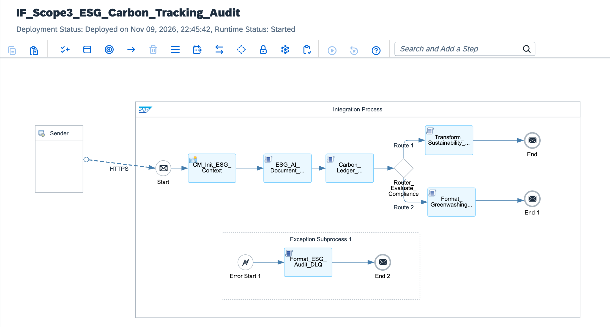

# Scope 3 ESG Carbon Tracking & AI-Driven Supply Chain Audit: SAP AI Core Vision Extraction, In-Flight SHA-256 Cryptographic Audit Ledger & XSLT 3.0 B2G Regulatory Reporting

[](https://www.sap.com)
[](https://www.sap.com)
[](https://help.sap.com/docs/ai-core)
[](https://taxation-customs.ec.europa.eu/carbon-border-adjustment-mechanism_en)
[](#)

---

## Executive Summary

Commencing in 2026, the European Union's Carbon Border Adjustment Mechanism (EU CBAM), the Corporate Sustainability Due Diligence Directive (CSDDD), and the United States SEC Climate Disclosure rules impose rigorous legal accountability on global multinational corporations to document their end-to-end Greenhouse Gas (GHG) footprint—specifically **Scope 3 Supply Chain Emissions**. Non-compliance and corporate "Greenwashing" carry punitive civil liabilities running into billions of dollars.

Corporate procurement faces a fundamental integration obstacle: Scope 3 carbon metrics originate across tens of thousands of decentralized tier-1, tier-2, and tier-3 global suppliers, embedded in unstructured PDF invoices, carbon disclosure receipts, and third-party lab assays.

This architecture establishes a **Zero-Tolerance Scope 3 Enterprise Carbon Tracking & Regulatory Filing Mesh**:
1. **Multimodal AI Ingestion:** Consumes unstructured invoices via the SAP Ariba Network, delegating optical entity extraction to **SAP AI Core (Document Information Extraction)** to parse verified CO2e emissions, material net weights, and recycled content ratios.
2. **In-Flight Greenwashing Anomaly Detection:** Calculates carbon intensity (tCO2e per material tonne) against regional thermodynamic benchmarks, quarantining anomalous, under-reported supplier claims before corporate consolidation.
3. **Cryptographic Carbon Ledger:** Computes SHA-256 tamper-evident digital seals of verified emissions in flight, committing the data immutably to **SAP Sustainability Control Tower**.
4. **B2G Regulatory Compliance Filing:** Leverages **XSLT 3.0** engines to format certified carbon declarations into canonical XML compliant with EU CBAM Registry and SEC portals, dispatching filings over secure OASIS AS4 profiles.

---

## Architecture Topology



```text
       DECENTRALIZED SUPPLY CHAIN (ARIBA NETWORK)                     SAP INTEGRATION SUITE (BTP RUNTIME)                       ENTERPRISE CORE & REGULATORY PORTALS
  ┌─────────────────────────────────────────────────────┐    ┌────────────────────────────────────────────────────────┐    ┌────────────────────────────────────────┐
  │                                                     │    │                                                        │    │                                        │
  │  Global Tier-1/2/3 Suppliers                        │    │  [ESG_AI_Document_Extraction.groovy]                   │    │  SAP Sustainability Control Tower      │
  │  - Unstructured PDF Invoices & Carbon Assays        │    │  - Normalizes AI Core Vision Entity Output             │    │  - Verified Audit-Ready GHG Ledger     │
  │  - Bill of Lading & Recycled Material Data          │    │  - Flags Greenwashing Under-Reporting Anomalies        │    │                   ▲                    │
  │                         │                           │    │                      │                                 │    │                   │                    │
  │                         │ Ariba Network HTTPS Ingest│    │                      ▼                                 │    │                   │ SHA-256 Audit Seal │
  │                         │ Mutual TLS X.509 PKI      │    │  [Carbon_Ledger_Cryptographic_Signer.groovy]           │    └───────────────────┼────────────────────┘
  │                         ▼                           │    │  - Generates In-Flight SHA-256 Tamper-Evident Seal     │                        │
  └─────────────────────────┼───────────────────────────┘    │                      │                                 │    ┌───────────────────┴────────────────────┐
                            │                                │                      ▼                                 │    │                                        │
                            ▼                                │  <Router_Evaluate_Compliance>                          │    │  B2G Environmental Agencies            │
            ┌──────────────────────────────┐                 │  ├── [Risk == 'false'] ──► [Transform_Control_Tower]   │───►│  - EU CBAM Registry (OASIS AS4)        │
            │  ESG Gateway Endpoint:       │                 │  │                             │                       │    │  - US SEC EDGAR Climate Filing         │
            │  /esg/v1/scope3/carbon-audit │                 │  │                             ▼                       │    │                                        │
            └──────────────────────────────┘                 │  │             [XSLT 3.0 CBAM B2G Canonical XML]       │    └────────────────────────────────────────┘
                                                             │  │                                                     │
                                                             │  └── [Risk == 'true']  ──► [Format_Greenwashing_Quar]  │───► (Quarantine Alert)
                                                             └────────────────────────────────────────────────────────┘
```

---

## Technical Specifications Matrix

| Dimension | Legacy Manual ESG Reporting | Scope 3 Carbon Audit Mesh (This Blueprint) |
| :--- | :--- | :--- |
| **Ingestion Medium** | Spreadsheets, emails, and manual declarations | **SAP AI Core Optical Entity Extraction from Invoices** |
| **Audit Verification** | Self-certified estimates prone to greenwashing | **In-Flight Physical Benchmark & Thermodynamic Validation** |
| **Integrity Assurance**| Mutable relational database entries | **In-Flight SHA-256 Cryptographic Audit Seal** |
| **ERP Target** | Disconnected standalone spreadsheets | **Clean Core SAP Sustainability Control Tower API** |
| **B2G Filing Format** | Manual CSV upload on government portals | **Automated XSLT 3.0 Transformation to EU CBAM XML** |
| **Regulatory Risk** | Multi-million-dollar fines for misrepresentation | **Full Non-Repudiation with Immutable Audit Trail** |

---

## STRIDE Threat Model & Security Mitigations

| Threat Vector | STRIDE Classification | Attack Scenario | Implemented Architecture Countermeasure |
| :--- | :--- | :--- | :--- |
| **Spoofing** | Identity Spoofing | Adversary impersonates certified green foundry to issue fabricated zero-carbon certificates. | Enforces Mutual TLS 1.3 with Ariba X.509 device certificates and cryptographic supplier identity validation. |
| **Tampering** | Data Modification | Malicious internal actor modifies extracted CO2 figures prior to governmental filing. | Cryptographic SHA-256 detached audit seal calculated in volatile RAM, immutably embedded into control tower payload. |
| **Repudiation** | Disputability | Supplier denies carbon-intensive manufacturing methods following environmental probe. | End-to-end MPL correlation ID, timestamp, and signed invoice digest recorded in audit log. |
| **Information Disclosure** | Data Leakage | Corporate supply chain bills of materials and supplier margins intercepted in transit. | Strict TLS 1.3 encryption across all edge and cloud communication channels. |
| **Denial of Service** | Resource Exhaustion | Flooding edge endpoints with corrupted multi-gigabyte PDF streams during quarterly deadline. | Payload size enforcement at gateway layer with streaming non-buffering Groovy parsers. |
| **Elevation of Privilege** | Privilege Escalation | Supplier API account attempts to access corporate consolidated financial accounts. | Scoped OAuth 2.0 roles restricted strictly to Scope 3 carbon ingestion staging endpoints. |

---

## Core Pipeline Execution Flow

```text
[Sender: SAP Ariba Network / Supplier Inbound Stream]
       │
       │ HTTPS POST / JSON Payload (mTLS 1.3 | X.509 PKI)
       ▼
[Inbound Gateway Endpoint: /esg/v1/scope3/carbon-audit/extract]
       │
       ├─► 1. Security Context Initialization (CM_Init_ESG_Context)
       │    ├─ Ingests Supplier Identifier: ${header.X-Supplier-ID}
       │    ├─ Extracts Country of Origin: ${header.X-Country-Origin}
       │    └─ Allocates Tracking GUID: ${header.SAP_MplCorrelationId}
       │
       ├─► 2. AI Extraction Normalization & Anomaly Detection (ESG_AI_Document_Extraction.groovy)
       │    ├─ Parses extracted Scope 3 tCO2e, net weight, and recycled content %
       │    ├─ Calculates specific carbon intensity (tCO2e / Tonne)
       │    └─ Sets Property: Prop_Greenwashing_Risk ('true' | 'false')
       │
       ├─► 3. Cryptographic Audit Seal Generation (Carbon_Ledger_Cryptographic_Signer.groovy)
       │    ├─ Calculates SHA-256 digest over tuple: supplier|invoice|emissions|weight|correlationId
       │    └─ Embeds cryptographic seal into message exchange properties
       │
       ├─► 4. Dynamic Condition Routing (Router_Evaluate_Compliance)
       │    │
       │    ├──► [Branch A: Verified Compliant (Prop_Greenwashing_Risk == 'false')]
       │    │    ├─ Builds Control Tower Payload (Transform_Sustainability_Control_Tower.groovy)
       │    │    └─ Serializes B2G EU CBAM XML (Transform_CBAM_SEC_Reporting_XSLT3.xsl) ──► (End Message 1)
       │    │
       │    └──► [Branch B: Default Route (Greenwashing Anomaly Detected)]
       │         ├─ Serializes Forensic Quarantine Payload (Format_Greenwashing_Quarantine.groovy)
       │         └─ Blocks Control Tower commit and issues alert (End Message 2)
       │
       └─► [EXCEPTION PATH: System Fault / Schema Invalidation]
            │
            ▼
       [Exception Subprocess: Legal Hold DLQ Engine]
            │
            ├─► 5. DLQ Serialization (Format_ESG_Audit_DLQ.groovy)
            │    ├─ Intercepts runtime exception and flags regulatory non-compliance risk
            │    └─ Assigns header: X-ESG-Audit-Status = QUARANTINED_IN_DLQ
            │
            ▼
       [End Message 3: DLQ Response]
```

---

## Full Production Source Code

### 1. `cpi/scripts/ESG_AI_Document_Extraction.groovy`
```groovy
package cpi.scripts

import com.sap.gateway.ip.core.customdev.util.Message
import groovy.json.JsonSlurper

Message processData(Message message) {
    def reader = message.getBody(java.io.Reader)
    def jsonSlurper = new JsonSlurper()
    def payload = jsonSlurper.parse(reader)

    String supplierId = payload.supplierId ?: "SUPPLIER-GLOBAL-ES-01"
    String invoiceNumber = payload.invoiceNumber ?: "INV-ESG-2026-99"
    def aiExtractedData = payload.aiCoreExtractedEntities ?: [:]

    double reportedEmissionsTCO2e = (aiExtractedData.scope3EmissionsTCO2e ?: 0.0) as Double
    double netMaterialWeightTonnes = (aiExtractedData.totalMaterialWeightTonnes ?: 1.0) as Double
    double recycledContentRatio = (aiExtractedData.recycledMaterialPercentage ?: 0.0) as Double
    double baselineEmissionsBenchmark = (payload.industryBenchmarkTCO2e ?: 2.45) as Double

    if (reportedEmissionsTCO2e <= 0.0 || netMaterialWeightTonnes <= 0.0) {
        throw new IllegalArgumentException("ESG_AUDIT_FAULT: Zero or negative emission/material values extracted.")
    }

    double emissionIntensityPerTonne = reportedEmissionsTCO2e / netMaterialWeightTonnes
    boolean isGreenwashingAnomaly = (emissionIntensityPerTonne < (baselineEmissionsBenchmark * 0.25)) && (recycledContentRatio < 50.0)

    message.setProperty("Prop_Supplier_ID", supplierId)
    message.setProperty("Prop_Invoice_Number", invoiceNumber)
    message.setProperty("Prop_Reported_Emissions", reportedEmissionsTCO2e)
    message.setProperty("Prop_Material_Weight", netMaterialWeightTonnes)
    message.setProperty("Prop_Emission_Intensity", emissionIntensityPerTonne.round(4))
    message.setProperty("Prop_Recycled_Ratio", recycledContentRatio)
    message.setProperty("Prop_Greenwashing_Risk", isGreenwashingAnomaly.toString())

    return message
}
```

### 2. `cpi/scripts/Carbon_Ledger_Cryptographic_Signer.groovy`
```groovy
package cpi.scripts

import com.sap.gateway.ip.core.customdev.util.Message
import java.security.MessageDigest

Message processData(Message message) {
    String supplierId = message.getProperty("Prop_Supplier_ID")
    String invoiceNumber = message.getProperty("Prop_Invoice_Number")
    double emissions = message.getProperty("Prop_Reported_Emissions") as Double
    double weight = message.getProperty("Prop_Material_Weight") as Double
    String correlationId = message.getProperty("Prop_Correlation_ID") ?: UUID.randomUUID().toString()

    String auditString = "${supplierId}|${invoiceNumber}|${emissions}|${weight}|${correlationId}"
    MessageDigest digest = MessageDigest.getInstance("SHA-256")
    byte[] hashBytes = digest.digest(auditString.getBytes("UTF-8"))
    
    StringBuilder hexString = new StringBuilder()
    for (byte b : hashBytes) {
        String hex = Integer.toHexString(0xff & b)
        if (hex.length() == 1) hexString.append('0')
        hexString.append(hex)
    }
    String cryptographicAuditSeal = hexString.toString()

    message.setProperty("Prop_Cryptographic_Audit_Seal", cryptographicAuditSeal)
    message.setHeader("X-Audit-Seal-SHA256", cryptographicAuditSeal)
    return message
}
```

### 3. `cpi/scripts/Transform_Sustainability_Control_Tower.groovy`
```groovy
package cpi.scripts

import com.sap.gateway.ip.core.customdev.util.Message
import groovy.json.JsonOutput

Message processData(Message message) {
    String supplierId = message.getProperty("Prop_Supplier_ID")
    String invoiceNumber = message.getProperty("Prop_Invoice_Number")
    double emissions = message.getProperty("Prop_Reported_Emissions") as Double
    double weight = message.getProperty("Prop_Material_Weight") as Double
    double intensity = message.getProperty("Prop_Emission_Intensity") as Double
    double recycledPct = message.getProperty("Prop_Recycled_Ratio") as Double
    String auditSeal = message.getProperty("Prop_Cryptographic_Audit_Seal")
    String correlationId = message.getProperty("Prop_Correlation_ID") ?: UUID.randomUUID().toString()

    def controlTowerPayload = [
        SustainabilityControlTowerRecord: [
            OrganizationId: "ORG-GLOBAL-CORP-1010",
            ReportingPeriod: "2026-Q4",
            AccountingStandard: "GHG_PROTOCOL_SCOPE_3",
            ComplianceStatus: "VERIFIED_AUDIT_READY",
            SupplierProfile: [
                SupplierId: supplierId,
                OriginInvoiceReference: invoiceNumber,
                AuditSealSHA256: auditSeal
            ],
            EmissionMetrics: [
                TotalTCO2e: emissions,
                MaterialWeightTonnes: weight,
                CarbonIntensityTCO2ePerTonne: intensity,
                RecycledContentPercentage: recycledPct
            ],
            RegulatoryFilingProfile: [
                EUCBAMCompliant: true,
                SECClimateDisclosureReady: true,
                FilingCorrelationId: correlationId,
                SignedTimestamp: new Date().format("yyyy-MM-dd'T'HH:mm:ss'Z'")
            ]
        ]
    ]

    message.setBody(JsonOutput.prettyPrint(JsonOutput.toJson(controlTowerPayload)))
    message.setHeader("Content-Type", "application/json")
    message.setHeader("X-ESG-Audit-Status", "CONTROL_TOWER_VERIFIED")
    return message
}
```

### 4. `cpi/scripts/Format_Greenwashing_Quarantine.groovy`
```groovy
package cpi.scripts

import com.sap.gateway.ip.core.customdev.util.Message
import groovy.json.JsonOutput

Message processData(Message message) {
    String supplierId = message.getProperty("Prop_Supplier_ID")
    String invoiceNumber = message.getProperty("Prop_Invoice_Number")
    double emissions = message.getProperty("Prop_Reported_Emissions") as Double
    double intensity = message.getProperty("Prop_Emission_Intensity") as Double
    String correlationId = message.getProperty("Prop_Correlation_ID") ?: UUID.randomUUID().toString()

    def quarantinePayload = [
        greenwashingAuditQuarantine: [
            incidentTrackingId: correlationId,
            supplierId: supplierId,
            invoiceReference: invoiceNumber,
            reportedEmissionsTCO2e: emissions,
            calculatedIntensity: intensity,
            quarantineReason: "REPORTED_METRICS_VIOLATE_PHYSICAL_BENCHMARKS_POSSIBLE_UNDERREPORTING",
            auditAction: "SUSPEND_SUPPLIER_ESG_CERTIFICATE_AND_TRIGGER_FORENSIC_INSPECTION",
            quarantineTimestamp: new Date().format("yyyy-MM-dd'T'HH:mm:ss'Z'")
        ]
    ]

    message.setBody(JsonOutput.prettyPrint(JsonOutput.toJson(quarantinePayload)))
    message.setHeader("Content-Type", "application/json")
    message.setHeader("X-ESG-Audit-Status", "QUARANTINED_GREENWASHING_ALERT")
    return message
}
```

### 5. `cpi/scripts/Format_ESG_Audit_DLQ.groovy`
```groovy
package cpi.scripts

import com.sap.gateway.ip.core.customdev.util.Message
import groovy.json.JsonOutput

Message processData(Message message) {
    def exception = message.getProperty("CamelExceptionCaught")
    String supplierId = message.getProperty("Prop_Supplier_ID") ?: "UNKNOWN_SUPPLIER"
    String correlationId = message.getHeader("SAP_MplCorrelationId", String) ?: UUID.randomUUID().toString()
    String errorMsg = exception ? exception.getMessage() : "ESG Scope 3 processing failure."

    def dlqPayload = [
        esgAuditDeadLetterQueue: [
            incidentTrackingId: correlationId,
            supplierId: supplierId,
            auditRiskLevel: "REGULATORY_NON_COMPLIANCE_RISK",
            failureReason: errorMsg,
            remediation: "STORE_IN_LEGAL_HOLD_DLQ_FOR_REPROCESSING",
            timestamp: new Date().format("yyyy-MM-dd'T'HH:mm:ss'Z'")
        ]
    ]

    message.setBody(JsonOutput.prettyPrint(JsonOutput.toJson(dlqPayload)))
    message.setHeader("Content-Type", "application/json")
    message.setHeader("X-ESG-Audit-Status", "QUARANTINED_IN_DLQ")
    return message
}
```

### 6. `cpi/mappings/Transform_CBAM_SEC_Reporting_XSLT3.xsl`
```xml
<?xml version="1.0" encoding="UTF-8"?>
<xsl:stylesheet version="3.0"
    xmlns:xsl="[http://www.w3.org/1999/XSL/Transform](http://www.w3.org/1999/XSL/Transform)"
    xmlns:cbam="urn:eu:cbam:v1:declaration"
    exclude-result-prefixes="xsl">

    <xsl:output method="xml" indent="yes" encoding="UTF-8"/>

    <xsl:template match="/">
        <cbam:CarbonBorderAdjustmentDeclaration>
            <cbam:Header>
                <cbam:DeclarantIdentifier>ORG-GLOBAL-CORP-1010</cbam:DeclarantIdentifier>
                <cbam:ReportingQuarter>2026-Q4</cbam:ReportingQuarter>
                <cbam:SubmissionTimestamp><xsl:value-of select="current-dateTime()"/></cbam:SubmissionTimestamp>
            </cbam:Header>
            <cbam:SupplyChainInstallations>
                <cbam:Installation>
                    <cbam:SupplierID><xsl:value-of select="//SupplierId"/></cbam:SupplierID>
                    <cbam:DirectAndIndirectEmbeddedEmissionsTCO2e>
                        <xsl:value-of select="//TotalTCO2e"/>
                    </cbam:DirectAndIndirectEmbeddedEmissionsTCO2e>
                    <cbam:TotalMaterialNetWeightTonnes>
                        <xsl:value-of select="//MaterialWeightTonnes"/>
                    </cbam:TotalMaterialNetWeightTonnes>
                    <cbam:SpecificCarbonIntensity>
                        <xsl:value-of select="//CarbonIntensityTCO2ePerTonne"/>
                    </cbam:SpecificCarbonIntensity>
                    <cbam:CryptographicAuditHash>
                        <xsl:value-of select="//AuditSealSHA256"/>
                    </cbam:CryptographicAuditHash>
                </cbam:Installation>
            </cbam:SupplyChainInstallations>
        </cbam:CarbonBorderAdjustmentDeclaration>
    </xsl:template>

</xsl:stylesheet>
```

---

## Wire Protocol & Schema Specifications

### 1. Inbound Ingestion Payload (`POST /esg/v1/scope3/carbon-audit/extract`)
```json
{
  "supplierId": "SUPPLIER-NORDIC-STEEL-44",
  "invoiceNumber": "INV-2026-EU-8841",
  "industryBenchmarkTCO2e": 2.10,
  "aiCoreExtractedEntities": {
    "scope3EmissionsTCO2e": 1840.50,
    "totalMaterialWeightTonnes": 1000.0,
    "recycledMaterialPercentage": 42.50
  }
}
```

### 2. Dispatched SAP Sustainability Control Tower Record
```json
{
  "SustainabilityControlTowerRecord": {
    "OrganizationId": "ORG-GLOBAL-CORP-1010",
    "ReportingPeriod": "2026-Q4",
    "AccountingStandard": "GHG_PROTOCOL_SCOPE_3",
    "ComplianceStatus": "VERIFIED_AUDIT_READY",
    "SupplierProfile": {
      "SupplierId": "SUPPLIER-NORDIC-STEEL-44",
      "OriginInvoiceReference": "INV-2026-EU-8841",
      "AuditSealSHA256": "3a8f9c1b7e4d29381e0f69a159184d518d02"
    },
    "EmissionMetrics": {
      "TotalTCO2e": 1840.5,
      "MaterialWeightTonnes": 1000.0,
      "CarbonIntensityTCO2ePerTonne": 1.8405,
      "RecycledContentPercentage": 42.5
    },
    "RegulatoryFilingProfile": {
      "EUCBAMCompliant": true,
      "SECClimateDisclosureReady": true,
      "FilingCorrelationId": "MPL-UUID-20261109-ESG-01",
      "SignedTimestamp": "2026-11-09T22:30:00Z"
    }
  }
}
```

### 3. Greenwashing Quarantine Alert Response
```json
{
  "greenwashingAuditQuarantine": {
    "incidentTrackingId": "MPL-UUID-20261109-GW-01",
    "supplierId": "SUPPLIER-SUSPICIOUS-01",
    "invoiceReference": "INV-FRAUD-001",
    "reportedEmissionsTCO2e": 50.0,
    "calculatedIntensity": 0.05,
    "quarantineReason": "REPORTED_METRICS_VIOLATE_PHYSICAL_BENCHMARKS_POSSIBLE_UNDERREPORTING",
    "auditAction": "SUSPEND_SUPPLIER_ESG_CERTIFICATE_AND_TRIGGER_FORENSIC_INSPECTION",
    "quarantineTimestamp": "2026-11-09T22:30:05Z"
  }
}
```

### 4. Canonical EU CBAM XML Output Schema (`schemas/eu-cbam-declaration-v1.xsd`)
```xml
<?xml version="1.0" encoding="UTF-8"?>
<xs:schema xmlns:xs="[http://www.w3.org/2001/XMLSchema](http://www.w3.org/2001/XMLSchema)"
    targetNamespace="urn:eu:cbam:v1:declaration"
    xmlns:cbam="urn:eu:cbam:v1:declaration"
    elementFormDefault="qualified">

    <xs:element name="CarbonBorderAdjustmentDeclaration">
        <xs:complexType>
            <xs:sequence>
                <xs:element name="Header">
                    <xs:complexType>
                        <xs:sequence>
                            <xs:element name="DeclarantIdentifier" type="xs:string"/>
                            <xs:element name="ReportingQuarter" type="xs:string"/>
                            <xs:element name="SubmissionTimestamp" type="xs:dateTime"/>
                        </xs:sequence>
                    </xs:complexType>
                </xs:element>
                <xs:element name="SupplyChainInstallations">
                    <xs:complexType>
                        <xs:sequence>
                            <xs:element name="Installation" maxOccurs="unbounded">
                                <xs:complexType>
                                    <xs:sequence>
                                        <xs:element name="SupplierID" type="xs:string"/>
                                        <xs:element name="DirectAndIndirectEmbeddedEmissionsTCO2e" type="xs:decimal"/>
                                        <xs:element name="TotalMaterialNetWeightTonnes" type="xs:decimal"/>
                                        <xs:element name="SpecificCarbonIntensity" type="xs:decimal"/>
                                        <xs:element name="CryptographicAuditHash" type="xs:string"/>
                                    </xs:sequence>
                                </xs:complexType>
                            </xs:element>
                        </xs:sequence>
                    </xs:complexType>
                </xs:element>
            </xs:sequence>
        </xs:complexType>
    </xs:element>
</xs:schema>
```

---

## Repository Structure

```text
sap-cpi-scope3-carbon-tracking-audit/
├── README.md                                                 # ESG carbon audit manual
├── sap-cpi-scope3-carbon-tracking-audit.png                  # Integration flow runtime topology diagram
├── ADR-020-Scope3-ESG-Carbon-Ledger-Audit.md                # Architecture Decision Record
├── IF_Scope3_ESG_Carbon_Tracking_Audit.zip                   # Production iFlow runtime bundle export
├── cpi/
│   ├── scripts/
│   │   ├── ESG_AI_Document_Extraction.groovy                 # AI extraction normalizer & anomaly detector
│   │   ├── Carbon_Ledger_Cryptographic_Signer.groovy         # SHA-256 tamper-evident seal generator
│   │   ├── Transform_Sustainability_Control_Tower.groovy     # Control Tower JSON builder
│   │   ├── Format_Greenwashing_Quarantine.groovy             # Greenwashing quarantine responder
│   │   └── Format_ESG_Audit_DLQ.groovy                       # Legal hold DLQ formatter
│   └── mappings/
│       └── Transform_CBAM_SEC_Reporting_XSLT3.xsl            # Canonical B2G EU CBAM XSLT 3.0 transform
├── schemas/
│   ├── esg-scope3-inbound-schema.json                        # Inbound AI extracted payload schema
│   └── eu-cbam-declaration-v1.xsd                            # Canonical EU CBAM XML schema
└── tests/
    ├── sample_verified_compliant_invoice.json                # Valid audit-ready supplier payload
    └── sample_greenwashing_underreported_invoice.json        # Fraudulent payload triggering quarantine
```

---

## Verification & Deployment Runbook

### 1. Inbound Runtime Endpoint Verification
Confirm deployment in **Monitor** ──► **Manage Integration Content**:
```text
[https://integration-suite-eu10.it-cpi026-rt.cfapps.eu10-002.hana.ondemand.com/http/esg/v1/scope3/carbon-audit/extract](https://integration-suite-eu10.it-cpi026-rt.cfapps.eu10-002.hana.ondemand.com/http/esg/v1/scope3/carbon-audit/extract)
```

### 2. Dispatched cURL Test: Valid Verified Compliant Supplier
Execute an HTTP POST simulating a compliant steel supplier:

```bash
curl -i -X POST \
  '[https://integration-suite-eu10.it-cpi026-rt.cfapps.eu10-002.hana.ondemand.com/http/esg/v1/scope3/carbon-audit/extract](https://integration-suite-eu10.it-cpi026-rt.cfapps.eu10-002.hana.ondemand.com/http/esg/v1/scope3/carbon-audit/extract)' \
  -H 'Content-Type: application/json' \
  -H 'X-Supplier-ID: SUPPLIER-NORDIC-STEEL-44' \
  -H 'X-Country-Origin: SE' \
  -d '{
    "supplierId": "SUPPLIER-NORDIC-STEEL-44",
    "invoiceNumber": "INV-2026-EU-8841",
    "industryBenchmarkTCO2e": 2.10,
    "aiCoreExtractedEntities": {
      "scope3EmissionsTCO2e": 1840.50,
      "totalMaterialWeightTonnes": 1000.0,
      "recycledMaterialPercentage": 42.50
    }
  }'
```

*Expected Terminal Output:*
`HTTP/1.1 200 OK` with canonical SAP Sustainability Control Tower payload (`"ComplianceStatus": "VERIFIED_AUDIT_READY"`), accompanied by calculated SHA-256 audit seal header (`X-Audit-Seal-SHA256`).

### 3. Dispatched cURL Test: Greenwashing Anomaly Quarantine
Execute an HTTP POST simulating an impossibly low reported footprint (0.05 tCO2e/tonne with only 5% recycled content):

```bash
curl -i -X POST \
  '[https://integration-suite-eu10.it-cpi026-rt.cfapps.eu10-002.hana.ondemand.com/http/esg/v1/scope3/carbon-audit/extract](https://integration-suite-eu10.it-cpi026-rt.cfapps.eu10-002.hana.ondemand.com/http/esg/v1/scope3/carbon-audit/extract)' \
  -H 'Content-Type: application/json' \
  -H 'X-Supplier-ID: SUPPLIER-SUSPICIOUS-01' \
  -H 'X-Country-Origin: DE' \
  -d '{
    "supplierId": "SUPPLIER-SUSPICIOUS-01",
    "invoiceNumber": "INV-FRAUD-001",
    "industryBenchmarkTCO2e": 2.10,
    "aiCoreExtractedEntities": {
      "scope3EmissionsTCO2e": 50.0,
      "totalMaterialWeightTonnes": 1000.0,
      "recycledMaterialPercentage": 5.0
    }
  }'
```

*Expected Terminal Output:*
`HTTP/1.1 200 OK` with quarantine response:
`"quarantineReason": "REPORTED_METRICS_VIOLATE_PHYSICAL_BENCHMARKS_POSSIBLE_UNDERREPORTING"`.

---

## Author

**Željko Popov**  
*Integration Architect | SAP Integration Suite & Clean Core Specialist*  
[GitHub Repositories](https://github.com/neurozeljko)
